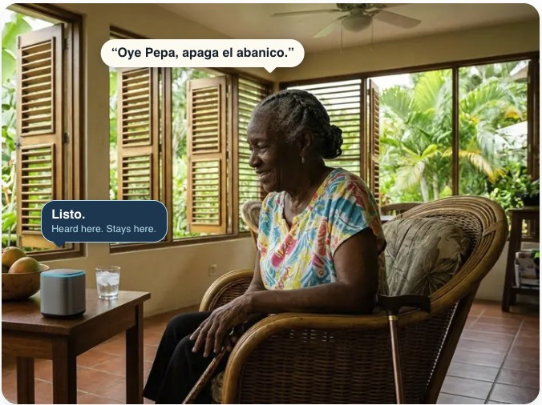

# Pepa Sensory Arm — House

[](https://opensource.org/licenses/MIT)
[](https://www.home-assistant.io/)
[](#installation)

The house scope of the Pepa Sensory Arm: a Home Assistant (HA) conversation agent that gives Pepa its senses, muscles and voice inside the home. Reflex-first, local-first.

> **Status: rebuild in progress.** This repository was restarted from a clean copy of upstream [Home Agent](https://github.com/aradlein/hass-agent-llm) by Anton Radlein (version 0.9.5, tagged here as the `radlein-base` pre-release). Pepa-specific changes from the earlier `pepa-sensory-arm` repository are being brought over one at a time, each judged against the scope framing below, not replayed mechanically. The code behaves like upstream Home Agent except for the changes listed under [Added in this repository](#added-in-this-repository). It has been renamed: the integration appears as "Pepa Sensory Arm House" and its domain, service and event names start with `pepa_sensory_arm_house` (version 1.0.0-alpha). To Home Assistant it is a new integration, separate from upstream Home Agent (`home_agent`) and from the earlier `pepa_sensory_arm`.

## Where this fits

[Pepa](https://ai4aging.org) is a self-hosted, no-cloud assistant that helps an older adult stay independent in their own home, in English and español. Its architecture is octopus-inspired: a central Head and several semi-autonomous arms.

<p align="center">
  
</p>

<p align="center"><sub><strong>AI Generated.</strong> Illustration, not a photo of a real person. She asks her house to switch off the fan; the house does it, and the voice never leaves it.</sub></p>

The **Sensory Arm** (PSA) is the boundary between Pepa and the physical world. It perceives, delivers and collects raw data, and it does not decide what that data means. It has two scopes so far:

- **House** (this repository): the senses, muscles and voice. It perceives the house, acts on it, and speaks in it. Real time, with parts deliberately exposed to Pepa's conversation.
- **Human telemetry**: the internal organs. Collection only, inward only, never exposed to conversation. Its code, when there is some, goes in a separate repository, `pepa-sensory-arm-person` (D-16), and it runs on its own Home Assistant instance. It will never run this code.

Read more: [The Sensory Arm](https://ai4aging.org/arms/sensory/the-sensory-arm/) · [House Sensing](https://ai4aging.org/arms/sensory/house-sensing/) · [Decision Register](https://ai4aging.org/arms/sensory/decisions/)

## What the house scope does, and what it never does

This repository is the house scope's front end: voice conversation, the ReAct (reason-and-act) tool loop, and the actuation tools. The rules it is built to follow come from the [Decision Register](https://ai4aging.org/arms/sensory/decisions/) (cited here by ID, such as D-05):

- **Reflexes only.** A Pepa arm reflex is a response that an arm completes on its own, from stimulus to effect, through rules declared in advance, without consulting the Head or another arm; others learn of it afterward, through the arm's ledger, never before (D-14). The house scope narrows that to direct, requested house actions, using explicit, declared and guardrailed rules, never beyond them (D-05). *"Apaga el abanico de la oficina"* is a reflex. Nothing upstream is consulted.
- **Asks before what cannot be undone.** An entity is reversible only when it carries the `reverse` label. Any other action waits for a person's yes, from the same satellite or conversation; a request nobody there can confirm is refused (D-17).
- **Requests from other arms are not reflexes.** When the Head or another arm asks it to speak, deliver an alarm or act on its behalf, the decision is theirs; this code answers for carrying it out faithfully and records it as done at their request. Such requests are bound by its physical limits and its own authority limits, whoever asked (D-15).
- **Anything else goes up.** A request that is not about the house is handed on rather than improvised. Health information spoken to Pepa is not housework: the house scope punts it and voices only whatever reply comes back (D-11).
- **Alarms are delivered, not decided.** Shower safety and similar signals are observations, not conclusions. The house scope can deliver an alarm. Deciding that one is warranted is not its job (D-12).
- **Raw and declared.** What it collects is kept as received, and whatever it receives must be declared (D-06).
- **No cameras.** Pepa does not use cameras until a compelling use case appears. Any cameras in the house belong to a security plane outside Pepa (D-13).
- **No moving sensors.** A sensing device that moves on its own, such as a robot, is its own arm, not part of this one (D-03).
- **Only exposed entities.** The conversation sees only the entities exposed to it in Home Assistant.
- **Loud failures.** When the house scope cannot confirm that an action happened, it says so; it never fails silently.

## Give it its own Home Assistant

Pepa Sensory Arm – House is built for one purpose: to be part of a person's cognitive infrastructure, as described by the Pepa project. It assumes it is the only thing acting on the Home Assistant instance it runs in.

Do not share that instance with other integrations that change the state of the house, especially ones driven by AI: other conversation agents, assistants or remote-control services. The same goes for automations and scripts that were not created through Pepa's setup. The only exception is people using Home Assistant's own dashboards and control panels by hand.

Anything else that acts on the house bypasses Pepa. Pepa can't ask before an action that can't be undone, can't verify that it happened, and can't keep a complete record of what was done and why. Those three guarantees are what Pepa is for; without them, it is just another voice assistant.

Pepa follows the same rule: the person scope, which records human telemetry, runs on its own Home Assistant instance, not alongside the house scope.

A development or test instance may run other agents side by side; that is what it is for. A household may also keep another agent installed as a break-glass fallback for when Pepa is down. While that fallback acts, Pepa's guarantees don't hold.

## Features

### Added in this repository

- **Exposed-entity allow-list refreshed every turn.** Entities that appear after a cold boot (late Zigbee or MQTT discovery) are no longer locked out until a reload, on the voice path and through the integration's own service. From upstream pull request #44, extended here.
- **House catalog.** One shared answer to "what does the house expose?": the entities exposed to Assist, published as `sensor.pepa_entity_context` (state = entity count, attribute `csv` = a table of entity_id, name, area, aliases, domain, services, volatile, verify, reverse). The CSV stays byte-identical between turns so a prompt that includes it stays cacheable, and the tools' allow-list reads the same answer.
- **`verify` for slow-acting devices.** Give an entity the Home Assistant label `verify` (a carport gate, a lock). After a command, the agent does not claim success: it checks within 60 seconds that the entity reached the state the command implies. A failure is loud: spoken on the satellite that took the request when it can announce, and always a Home Assistant notification. Every outcome fires a `pepa_verify` event.
- **Ask before acting on what can't be undone.** Give an entity the Home Assistant label `reverse` when its actions can be undone; the house catalog shows it in a `reverse` column. Any other entity (no label, so a new or forgotten device fails closed) is not acted on straight away: the action is held, the agent asks a yes-or-no question, and the satellite keeps listening for the answer. Code, not the model, decides whether the answer is a yes, from fixed Spanish and English word lists; only a yes from the same satellite or conversation, within the wait (1 to 60 seconds, default 10), runs exactly the held action. A no cancels it and says so; anything else cancels it and is answered as a normal request. Requests through the integration's service can't be confirmed and are refused. Every step fires a `pepa_confirm` event.
- **Home Assistant's fast path can't skip the question.** With **Prefer handling commands locally** on (Home Assistant's default), Home Assistant answers some requests with its own built-in sentences before the agent sees them. Through a pipeline whose agent is this integration, it now does so only for questions (a state, the temperature, the time, the date, the weather) and for actions whose every target carries the `reverse` label. Any other request is handed to the agent, which asks first. The person hears no difference except the time the agent takes. This is on from install, with no setup, and other pipelines and agents are untouched. Automations with a sentence trigger run before everything and are not covered. Details: [Local handling guard](docs/LOCAL_HANDLING_GUARD.md).
- **Memory extraction through the external LLM** stores what it extracts instead of silently dropping it (upstream pull request #43).
- **Optional follow-up listening** (`continue_conversation`, off by default): the satellite reopens its microphone after a reply (upstream pull request #51).

See [NOTICE.md](NOTICE.md) for credits.

### Inherited from upstream Home Agent

These work because the code base is upstream's. As each is re-adopted into Pepa, it will be reviewed against the rules above.

- **Any OpenAI-compatible LLM endpoint** (LLM = large language model). Works with Ollama, LM Studio, LocalAI and similar. See the note on local-first below.
- **Entity context**: relevant entity states are provided to the model automatically.
- **Conversation history** with persistent storage, kept per user and device.
- **Native tools**: `ha_control` and `ha_query` for acting on and reading the house.
- **Custom tools**: REST API and Home Assistant service tools, defined in YAML configuration.
- **External LLM tool**: hands a request that is beyond the house to another model.
- **Streaming responses** for low-latency voice, using the Wyoming protocol text-to-speech (TTS).
- **Vector database context** (optional): semantic entity search with ChromaDB.
- **Memory system** (optional): automatic extraction and recall of facts, using ChromaDB.
- **Events** for automation triggers and monitoring.

### Local-first

Pepa's rule is that nothing leaves the house. The inherited code can talk to cloud providers (OpenAI, Azure OpenAI), but a Pepa installation should point it at a model served on your own network. Cloud endpoints remain a technical option here, not a supported Pepa configuration.

## Requirements

**Required**

- Home Assistant 2026.11 or later (the minimum declared in `hacs.json` and the version the tests run against, on Python 3.14). Earlier versions are not supported: 2026.11 changed how tool results pass through the conversation, and this integration uses the new form. On an earlier Home Assistant, stay on the earlier [`pepa-sensory-arm`](https://github.com/prsws/pepa-sensory-arm).
- `aiohttp >= 3.9.0` (included with Home Assistant)

**Optional**

- ChromaDB (`chromadb-client == 1.5.3`): vector database context and the memory system
- Embeddings: `openai >= 1.3.8`, or use Ollama
- Wyoming protocol TTS: streaming voice responses

**If you ran the earlier `pepa-sensory-arm`**: remove its `entities_list` pyscript before installing this. Both publish `sensor.pepa_entity_context` and would overwrite each other.

## Installation

This repository is not in the community catalog, so it is installed as a *custom repository*. Community content is made and supported by its authors, not by the Home Assistant project; Home Assistant shows a warning saying so before you install.

### Marketplace

Starting with 2026.11, the Home Assistant Community Store (HACS) is built into Home Assistant as the **Marketplace** (**Settings** → **Marketplace**). If you already had HACS, Home Assistant migrates it on first start, including your custom repositories. HACS can no longer be installed on 2026.11 or later.

1. Open this link from a browser that can reach your Home Assistant instance. It opens this repository in your Marketplace and offers to add it as a custom repository:
   [](https://my.home-assistant.io/redirect/hacs_repository/?owner=prsws&repository=pepa-sensory-arm-house&category=integration)
2. Adding a custom repository needs a GitHub connection (a GitHub account). Browsing and installing from the main catalog does not.
3. Install it. An integration with a setup flow that was not loaded before starts right away; otherwise a repair notice offers a restart.
4. Go to **Settings** → **Devices & Services** → **Add Integration**, search for "Pepa Sensory Arm House", and follow the wizard.

Updates appear under **Settings** → **Updates**, next to Home Assistant's own.

### Manual

1. Download the latest release from this repository.
2. Copy `custom_components/pepa_sensory_arm_house` into your Home Assistant `config/custom_components` folder.
3. Restart Home Assistant and add the integration as above.

### One repository per integration name

Home Assistant allows only one installed repository for each integration domain (the internal name, here `pepa_sensory_arm_house`). Upstream Home Agent (`home_agent`) and the earlier Pepa Sensory Arm (`pepa_sensory_arm`) have different domains, so they can be installed side by side with this one, for example while testing. Configuration and history do not carry over from them: this is set up as a new integration.

Details: [Installation Guide](docs/INSTALLATION.md)

## Quick start

### 1. Add the integration

In **Settings** → **Devices & Services** → **Add Integration**, configure:

- **Name**: a friendly name
- **LLM Base URL**: your OpenAI-compatible endpoint, for example Ollama on your network at `http://<your-server>:11434/v1`
- **API Key**: only if your endpoint requires one
- **Model**: the model name your endpoint serves
- **Temperature**: 0.7 is a reasonable start
- **Max Tokens**: 500, adjusted to your needs

### 2. Try it

Call the conversation service:

```yaml
service: pepa_sensory_arm_house.process
data:
  text: "Turn on the living room lights"
```

(Upstream's `home_agent.process` is now `pepa_sensory_arm_house.process`; the same goes for every service and event name.)

### 3. Go further

Open **Settings** → **Devices & Services** → this integration → **Configure** to set the context mode, conversation history, custom tools, external LLM, memory, and streaming.

To have slow devices checked after each command, add the label `verify` to them in Home Assistant (**Settings** → **Labels**, then on the entity).

To let the agent act without asking first, add the label `reverse` to the entities whose actions can be undone (lights, fans, media players). Until you do, every action asks for a yes. The same label is what lets Home Assistant act on them straight away when **Prefer handling commands locally** is on; without it, those requests go to the agent. The wait for the answer is under **Tool Configuration** → **Confirmation Wait (seconds)**.

Details: [Configuration Reference](docs/CONFIGURATION.md)

## Usage examples

### Voice

```
"Turn on the kitchen lights to 50%"
"Is the front door locked?"
"Apaga el abanico de la oficina"
```

### Automation

```yaml
automation:
  - alias: "Morning Briefing"
    trigger:
      - platform: time
        at: "07:00:00"
    action:
      - service: pepa_sensory_arm_house.process
        data:
          text: "Good morning! Please prepare for the day."
          conversation_id: "morning_routine"
```

### React to a failed verification

```yaml
automation:
  - alias: "Gate did not confirm"
    trigger:
      - platform: event
        event_type: pepa_verify
        event_data:
          outcome: failed
    action:
      - service: notify.notify
        data:
          message: "{{ trigger.event.data.entity_id }} did not reach {{ trigger.event.data.expected }}"
```

### Custom tool

Custom tools are defined in YAML (`configuration.yaml`). Point REST tools at services on your own network; a call that leaves the house goes against Pepa's no-cloud rule.

```yaml
pepa_sensory_arm_house:
  tools_custom:
    - name: check_weather
      description: "Get weather forecast"
      handler:
        type: rest
        url: "http://<your-weather-service>/forecast"
        method: GET
```

More: [Examples](docs/EXAMPLES.md)

## Voice conversation persistence

The agent keeps conversation context across voice interactions, so follow-up questions work.

- Each user and device combination has its own session.
- Sessions expire after one hour of inactivity by default. The timeout is configurable from 1 minute to 2 hours (set in minutes).
- Each device has an independent context: the kitchen satellite remembers kitchen conversations, and the same person on a different device starts a new one.

```
User:  "What's the temperature in the living room?"
Agent: "The living room is 72°F"
[Later]
User:  "What about the bedroom?"
Agent: "The bedroom temperature is 68°F"
```

Reset a conversation with the `clear_conversation` service:

```yaml
# Current user and device
service: pepa_sensory_arm_house.clear_conversation

# A specific device
service: pepa_sensory_arm_house.clear_conversation
data:
  device_id: "kitchen_satellite"
```

## Documentation

The `docs/` files are inherited from upstream. Names, services and links have been updated for the rename; their content has not yet been revised against Pepa's rules.

- **Start here**: [Installation](docs/INSTALLATION.md) · [Configuration](docs/CONFIGURATION.md) · [Example configurations](docs/EXAMPLE_CONFIGS.md) · [FAQ](docs/FAQ.md)
- **Features**: [Memory system](docs/MEMORY_SYSTEM.md) · [Vector DB setup](docs/VECTOR_DB_SETUP.md) · [Custom tools](docs/CUSTOM_TOOLS.md) · [External LLM](docs/EXTERNAL_LLM.md)
- **Reference**: [Architecture](docs/ARCHITECTURE.md) · [API reference](docs/API_REFERENCE.md) · [Troubleshooting](docs/TROUBLESHOOTING.md) · [Examples](docs/EXAMPLES.md) · [Migration guide](docs/MIGRATION.md)

## Contributing

Contributions are welcome. The `main` branch is protected: changes arrive by pull request, with linear history and no force-pushes.

1. Fork the repository and create a feature branch.
2. Write tests for new functionality.
3. Make sure the tests pass (see [Testing](#testing)).
4. Follow the [contributing guide](CONTRIBUTING.md) (inherited from upstream).
5. Open a pull request.

Because history is linear, merge commits are not allowed: pull requests are merged with **Squash** or **Rebase and merge**. Contributions harvested from upstream are merged with **Rebase and merge**, so their authors stay the commit authors.

To stay installable from the Marketplace, the repository needs a valid `hacs.json` at its root (the Marketplace cannot install or update without it), a `version` in `manifest.json` that matches the release tag (and `VERSION` in `const.py`), and an `issue_tracker` entry. The HACS validation action and `hassfest` (Home Assistant's own manifest checker) run on every pull request and must pass.

Changes should respect the rules in [What the house scope does, and what it never does](#what-the-house-scope-does-and-what-it-never-does). If a decision in the [Decision Register](https://ai4aging.org/arms/sensory/decisions/) looks wrong, raise it as a question rather than working around it in code.

## Testing

Python 3.14 (Home Assistant 2026.11 requires 3.14.2 or later).

```bash
python3 -m venv venv
source venv/bin/activate
pip install -r requirements.txt
pip install -r requirements_dev.txt

# What CI runs (tests that need a live LLM or ChromaDB are left out)
pytest tests/unit/ tests/integration/ \
  --ignore=tests/integration/test_real_llm.py \
  --ignore=tests/integration/test_real_memory.py \
  --ignore=tests/integration/test_real_vector_db.py \
  --ignore=tests/integration/test_real_ttft_metrics.py

# Unit tests only, with coverage
pytest tests/unit/ --cov=custom_components.pepa_sensory_arm_house --cov-report=html
```

## Support

- **Issues with this integration**: [GitHub Issues](https://github.com/prsws/pepa-sensory-arm-house/issues)
- **Issues with the Marketplace itself** (installing, updating, custom repositories): the [Home Assistant core issue tracker](https://github.com/home-assistant/core/issues), not this repository.
- **Pepa documentation**: [ai4aging.org](https://ai4aging.org)

## License and credits

MIT License: see [LICENSE](LICENSE), which carries both the Pepa Sensory Arm contributors' copyright and upstream's. Pepa is experimental software and a personal research project. It is not a medical device, an alarm, or an emergency system. In an emergency, call 911.

This repository is derived from [Home Agent](https://github.com/aradlein/hass-agent-llm) by Anton Radlein (MIT), which was itself inspired by the `extended_openai_conversation` integration. Upstream is no longer actively maintained; selected upstream pull requests are merged here, and development otherwise goes its own way. Credits for merged upstream work are in [NOTICE.md](NOTICE.md). Thanks to the Home Assistant community.

## Changelog

**1.0.0-alpha** (unreleased): rebuild from the upstream base; CI made green (dependency pins, formatting, `hassfest`); upstream pull requests #44, #43 and #51 merged; exposed-entity allow-list refreshed every turn, including the service path; house catalog published as `sensor.pepa_entity_context`; `verify` checks for slow-acting devices with loud failures; `reverse` label and catalog column (no label = not reversible) with a spoken yes-or-no before any action on what can't be undone; renamed from `home_agent` to `pepa_sensory_arm_house` ("Pepa Sensory Arm House"), with Pepa's brand icons and `iot_class` set to `local_polling`; requires Home Assistant 2026.11 or later (tool results as `ToolResult`; earlier versions stay on the earlier `pepa-sensory-arm`); local handling guard: with **Prefer handling commands locally** on, Home Assistant answers Pepa's pipelines by itself only for questions and for actions on entities labelled `reverse`, and hands everything else to the agent; Pepa changes being re-adopted one at a time.

**0.9.5 and earlier**: upstream Home Agent history. See the [upstream releases](https://github.com/aradlein/hass-agent-llm/releases).
